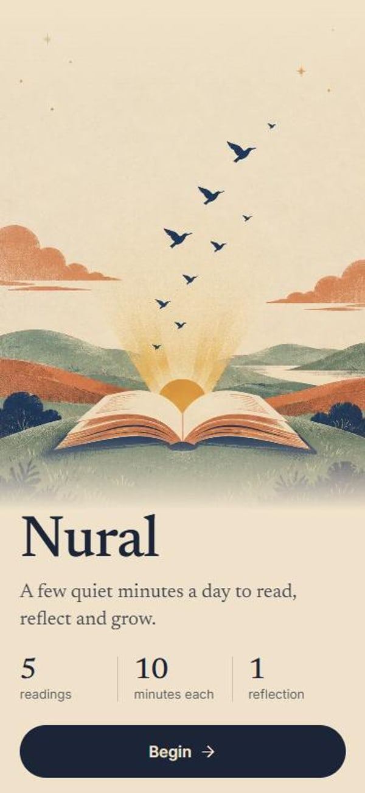
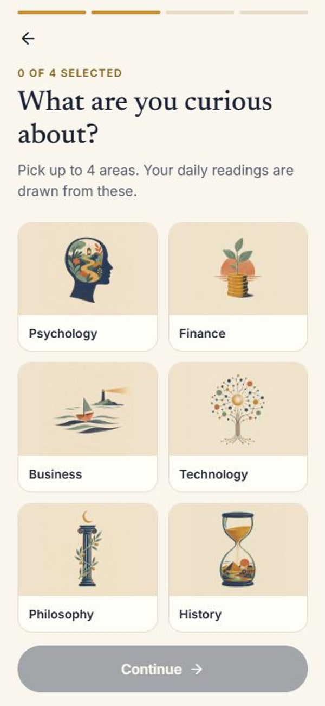
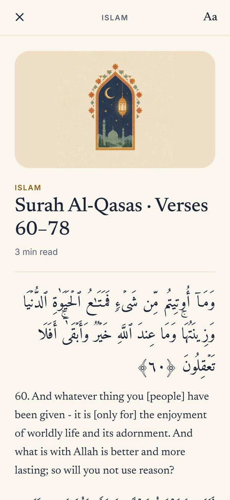
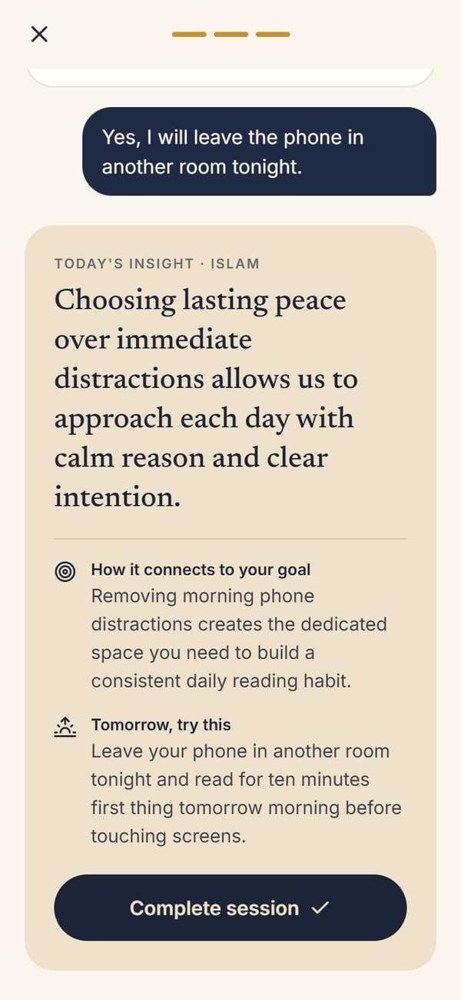

# Nural

A daily reading and reflection app. Each day Nural prepares five short readings matched to your interests, and after each one an AI companion asks what you took from it and helps you connect it to your own goals.

Built with Expo (React Native), Supabase and Google Gemini.

<p>
  
  
  
  
</p>

## What it does

- **Personal onboarding.** You choose a spiritual path (Islam, Christianity, Buddhism, Stoicism, Mindfulness or none), up to four learning areas out of sixteen, and answer four short questions about your goals and challenges.
- **Five readings a day.** One from your spiritual path, the rest from your learning areas: a passage of about ten minutes each, taken from public-domain books, the Quran or the Bible. A day never repeats the same book.
- **A reader made for reading.** Serif type, adjustable text size, light and dark themes, a scroll progress bar, and Quranic Arabic set right-to-left with its translation verse by verse.
- **Reflection with an AI companion.** After reading, Nural first asks one question about the text itself. Answers that show you have not read it are turned back kindly, with a way back to the reading. Once you have, the conversation moves to your own life and ends with an insight card: a takeaway, how it connects to your goal, and one small thing to try tomorrow.
- **Progress.** Streaks, total sessions, real reading time, a weekly chart and a monthly calendar.
- **Editable profile.** Change your path, interests and goals at any time.

## Tech stack

| Area | Choice |
| --- | --- |
| App | Expo SDK 57, React Native, TypeScript, Expo Router (file-based routing) |
| Data | Supabase (Postgres) for profiles, sessions, chat messages and streaks |
| AI | Google Gemini for the reflection conversation, with an automatic fallback model when the first is rate-limited |
| Content | Project Gutenberg, [alquran.cloud](https://alquran.cloud/api), [bible-api.com](https://bible-api.com) |
| UI | Custom design system with light and dark themes, Reanimated, Newsreader / Inter / Amiri fonts |

## Getting started

You need Node.js 20 or newer, a free [Supabase](https://supabase.com) project and a [Gemini API key](https://aistudio.google.com/apikey).

1. Install dependencies

   ```bash
   npm install
   ```

2. Create the database tables: open the SQL editor of your Supabase project and run [`supabase/schema.sql`](supabase/schema.sql).

3. Copy `.env.example` to `.env.local` and fill in your Supabase URL, Supabase anon key and Gemini API key.

4. Start the app and scan the QR code with [Expo Go](https://expo.dev/go)

   ```bash
   npx expo start
   ```

   If your phone is not on the same Wi-Fi as your computer, use `npx expo start --tunnel`. To try it in a browser, press `w`.

Useful checks:

```bash
npx tsc --noEmit   # type check
npm run lint       # lint
```

## How it works

1. **Onboarding** saves a profile to Supabase and caches it on the device, so the app opens instantly afterwards.
2. **Today** asks Supabase for today's sessions. If there are none yet, `lib/contentGenerator.ts` builds five: it picks a category for each slot, picks a book per category without repeating a title, fetches the texts in parallel and cuts a passage that starts and ends on a sentence.
3. **Reading** shows the passage and measures the time actually spent on it.
4. **Reflection** (`lib/aiChat.ts`) opens with a question about the text, has Gemini judge the answer generously, then continues with two personal questions and returns a structured summary.
5. **Completing** a session updates the streak and totals (`lib/progress.ts`), which the Today and Journey screens read back.

## Project structure

- `app/` — screens: `onboarding/`, `(tabs)/` (Today, Journey, You), `reading/[id]`, `chat`, `edit-profile`
- `components/` — shared UI: buttons, text fields, pickers, illustration panels, week strip
- `constants/` — `theme.ts` (colors, fonts, spacing), `options.ts` (paths, learning areas, questions)
- `contexts/` — profile state and theme / reading preferences
- `hooks/` — `useTodaySessions`, `useStreak`, `useCompletedCounts`
- `lib/` — content (`contentGenerator`, `bookReader`, `quranApi`, `bibleApi`), AI (`aiChat`, `gemini`), `progress`, `supabase`
- `assets/illustrations/` — one illustration per reading category
- `supabase/schema.sql` — database tables

### Adding a learning area or spiritual path

1. Add it to `constants/options.ts`.
2. Give it books in `GUTENBERG_LIBRARY` in `lib/bookReader.ts`. Spiritual paths also need an entry in `SPIRITUAL_CATEGORY` in `lib/contentGenerator.ts`.
3. Add an illustration to `assets/illustrations/` and register it in `lib/illustrations.ts`.

### Reading from your own books

Nural works out of the box with Project Gutenberg. To add your own texts, put `.txt` files in `assets/books/` together with a `library.json` that lists them; the format is described in [`lib/localLibrary.ts`](lib/localLibrary.ts). That folder is git-ignored.

## Planned

- Authentication with Supabase Auth
- Row-level security policies
- Gemini calls through a server-side function
